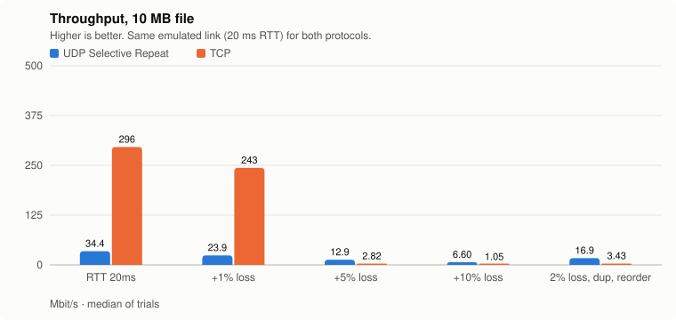
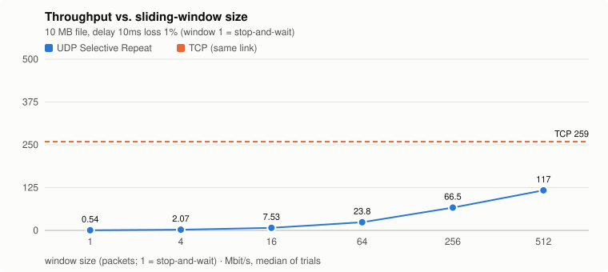

# Reliable File Transfer over UDP

A file transfer protocol built on raw UDP sockets in C++17. Reliability comes from
**Selective Repeat ARQ**: a sliding window, one timer per packet, selective
retransmission, and out-of-order buffering at the receiver. It is benchmarked
against TCP over the same emulated links (delay, loss, duplication, reordering).

```
udp_client file.bin ──START──▶ udp_server     (handshake: size, chunks, window)
                    ◀─START_ACK─              (receiver grants a window)
                    ──DATA #0..#N──▶          (up to W packets in flight)
                    ◀──ACK #i──               (one ACK per packet)
                    ──FIN(crc32)──▶           (whole-file checksum)
                    ◀─FIN_ACK(ok)─            (file is on disk and verified)
```

## Features

| Feature | Where |
|---|---|
| Packet segmentation into 1400-byte chunks, so DATA packets fit a 1500 MTU | `SelectiveRepeatSender::read_chunk` |
| Custom 16-byte header: version, type, length, **transaction ID**, **sequence number**, CRC32 | [`protocol.h`](include/rudp/protocol.h) |
| START / FIN handshake with retransmission. Late or duplicate control packets are answered the same way every time | `exchange()`, `ReceiverServer::on_start/on_fin` |
| **Selective Repeat** sliding window: up to W unacknowledged packets in flight | [`sr_sender.cpp`](src/sr_sender.cpp) |
| **Per-packet timeout** using an adaptive RTO (RFC 6298 SRTT/RTTVAR, Karn's algorithm, exponential backoff) | [`rtt_estimator.cpp`](src/rtt_estimator.cpp) |
| **Selective retransmission**: only packets whose own timer expired are re-sent | `retransmit_expired()` |
| **Flow control**: the receiver caps the window in START_ACK so it never has to buffer more than it can hold | `handshake()` |
| **Duplicate handling**: duplicate DATA is re-ACKed and never written twice. Duplicate ACKs are counted and ignored | [`receive_window.cpp`](src/receive_window.cpp) |
| **Out-of-order buffering** in a ring buffer the size of the window, written to disk in order as soon as a gap fills | `ReceiveWindow` |
| Integrity: CRC32 on every packet (corrupt packets are treated as lost) plus a CRC32 of the whole file checked at FIN | `decode_packet`, `on_fin` |
| Memory is O(window × chunk) on both sides, independent of file size. Files are streamed, never loaded whole | sender ring + receiver ring |
| One server handles many clients at once, separated by transaction ID. Idle sessions time out. Finished sessions stay around briefly to re-ACK late packets | [`sr_receiver.cpp`](src/sr_receiver.cpp) |
| In-process loss/duplication/reordering injection for testing without root | [`udp_socket.cpp`](src/udp_socket.cpp) |
| TCP baseline and a netem benchmark harness | [`tcp_transfer.cpp`](src/tcp_transfer.cpp), [`bench/`](bench) |

## Layout

```
include/rudp/          public headers (one module each)
  protocol.h           wire format, encode/decode, control payloads
  crc32.h              checksum
  udp_socket.h         RAII UDP socket + impairment injection
  rtt_estimator.h      adaptive retransmission timeout
  sr_sender.h          Selective Repeat sender
  receive_window.h     Selective Repeat receive window (pure logic, unit tested)
  sr_receiver.h        multi-transfer server built on ReceiveWindow
  tcp_transfer.h       TCP baseline
src/                   implementations
apps/                  udp_client, udp_server, tcp_client, tcp_server
tests/                 unit_tests.cpp, integration_test.sh
bench/                 benchmark.py (runs everything), report.py (tables + SVG charts)
legacy/                the first prototype (stop-and-go window, 10-byte chunks)
```

## Build and run

```bash
cmake -S . -B build && cmake --build build -j
```

```bash
./build/udp_server --port 9000 --out-dir received
```

```bash
./build/udp_client path/to/file --host 127.0.0.1 --port 9000 --window 64
```

The client prints time, throughput, retransmissions, duplicate ACKs, SRTT/RTO and
protocol overhead. Add `-v` to either side to trace every packet (`Sent DATA #12`,
`TIMEOUT DATA #7 -> retransmitting`, `DATA #9 out of order, buffered`, ...).
Add `--json` to the client for machine-readable output.

To watch the protocol recover from a bad network without root, inject impairments on both ends:

```bash
./build/udp_server --loss 0.2 --dup 0.1 -v
```

```bash
./build/udp_client big.iso --loss 0.2 --dup 0.1 --reorder 0.2 -v
```

## Tests

```bash
cd build && ctest --output-on-failure
```

* `unit_tests`: CRC check values, header round-trip, rejection of every single-bit
  corruption, control payloads, and receive-window behaviour (in-order delivery,
  buffering and gap filling, duplicates inside and behind the window, out-of-window
  drops). Also the RTO estimator math.
* `integration_test.sh`: real transfers of awkward sizes (0 B, 1 B, exactly one
  chunk, exact multiples, 3 MB) and transfers through **20% loss + 10% duplication
  + 20% reordering in both directions**, including window = 1 and 10-byte chunks.
  Every received file is compared byte for byte with `cmp`. It also checks the
  failure paths: a missing file, and a server that is down (the client gives up
  cleanly).

## Benchmark against TCP

```bash
python3 bench/benchmark.py            # full matrix, ~10-20 min
```

```bash
python3 bench/benchmark.py --quick    # 1 trial, small files
```

**Method.** The script re-runs itself inside a private network namespace
(`unshare -rn`, no root needed) and shapes that namespace's loopback with
**netem**. That way UDP and TCP go through exactly the same link: same delay,
loss, duplication and reordering, in both directions. The loopback is set up
like Ethernet (MTU 1500, TSO/GSO/GRO off) so TCP can't send 64 KB super-segments.
For each run it records:

* **transfer time / throughput**, end to end. The clock stops when the receiver
  confirms the file is on disk (FIN_ACK for UDP, a status byte for TCP).
* **retransmissions**: counted by the UDP sender, and `tcpi_total_retrans` from
  `TCP_INFO` for TCP.
* **wire bytes and packets**: the change in the namespace's loopback counters.
  Every header, ACK, retransmission and duplicate is included.
* **overhead** = wire bytes / file bytes − 1.

Each received file's SHA-256 is checked against the original. Results go to
`bench/results/`: `results.csv` (raw data), `results.md` (tables) and SVG charts.

### Results

Median of 3 trials. UDP window = 64 × 1400 B. All 129 transfers verified by SHA-256.
Full tables: [`bench/results/results.md`](bench/results/results.md).

| 10 MB file, link | UDP SR | TCP | Speed-up |
|---|---:|---:|---:|
| RTT 20 ms, 5% loss | **6.5 s** (12.9 Mbit/s) | 29.8 s (2.8 Mbit/s) | **4.6× UDP** |
| RTT 20 ms, 10% loss | **12.7 s** (6.6 Mbit/s) | 79.6 s (1.1 Mbit/s) | **6.3× UDP** |
| RTT 20 ms, 2% loss + 5% dup + 25% reorder | **5.0 s** (16.9 Mbit/s) | 24.5 s (3.4 Mbit/s) | **4.9× UDP** |
| RTT 20 ms, 1% loss | 3.5 s (23.9 Mbit/s) | **0.35 s** (243 Mbit/s) | 10× TCP |
| no shaping (loopback) | 0.057 s (1.46 Gbit/s) | **0.006 s** (13.5 Gbit/s) | 9× TCP |





**What the numbers show**

* **At high loss, Selective Repeat is 4–6× faster than TCP.** TCP treats every
  loss as congestion and halves its sending window, so at 5–10% random loss it
  almost stops. SR keeps the window full and re-sends only the lost packets.
* **TCP misreads reordering as loss.** With 25% reordering, duplicate ACKs make TCP
  fast-retransmit packets that were never lost. Its wire overhead rises to about 20%
  and it slows down. SR just buffers out-of-order packets (14% overhead, 4.9× faster).
* **At low loss on a high-latency link, TCP wins** because its window grows. Ours
  is fixed at 64 packets, so throughput is capped at 64 × 1400 B per 20 ms RTT ≈
  36 Mbit/s. The window sweep shows this directly: throughput grows almost linearly
  with the window, from 0.54 Mbit/s for stop-and-wait (window 1) to 117 Mbit/s at
  window 512.
* **On a link with no delay or loss, TCP is about 9× faster.** The kernel does
  segmentation and ACKing in bulk, while we make one system call per 1400-byte
  packet.
* **Overhead.** SR's headers and per-packet ACKs cost about 6% on a clean link,
  close to TCP's 4–5%. Under loss it rises to 12–18%, because every retransmission
  and lost ACK costs a full packet.

## Sliding-window ARQ: the three variants

| | Stop-and-Wait | Go-Back-N | **Selective Repeat (this project)** |
|---|---|---|---|
| Packets in flight | 1 | N | N |
| Receiver buffers out-of-order packets | – | no (discards them) | **yes** |
| ACK type | per packet | cumulative | **per packet (selective)** |
| On loss, retransmit | that packet | that packet **and everything after it** | **only that packet** |
| Timers | 1 | 1 (oldest packet) | **1 per packet** |
| Constraint | – | window ≤ 2^k − 1 | window ≤ 2^(k−1) |

Stop-and-Wait is Selective Repeat with `--window 1`, and the window sweep in
the benchmark measures it directly. Sequence numbers here are 32 bits and never wrap
(files up to ~5.6 TB at 1400 B/chunk), so the window ≤ half the sequence space
rule holds automatically.

## Known limitations

* No congestion control. The sender always keeps a full window in flight, which
  is why it beats TCP under random loss but would not be fair to other traffic on
  a shared, congested link.
* One `sendto` system call per packet. On a link with no delay or loss, TCP (kernel
  segmentation, large writes) is much faster. `sendmmsg` or UDP GSO would close
  most of that gap.
* IPv4 only. No encryption or authentication.
