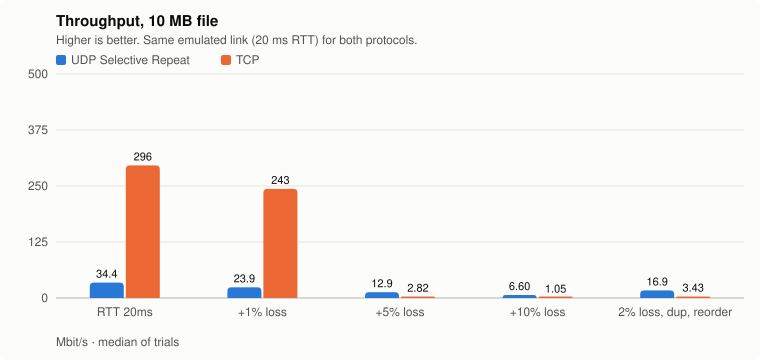
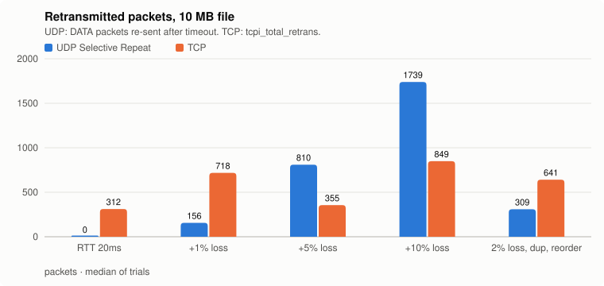
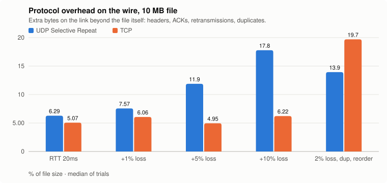
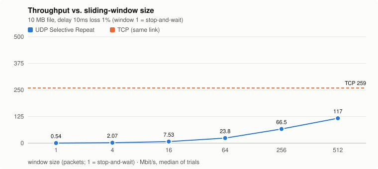

# Benchmark results

Generated by `bench/benchmark.py`. Each cell is the median of the trials. Network conditions are applied with netem on the loopback of a private network namespace (MTU 1500, offloads off), in both directions, identically for UDP and TCP.

## UDP (Selective Repeat) vs TCP

UDP window = 64 packets × 1400 B.

| condition | netem | size | UDP time (s) | TCP time (s) | UDP Mbit/s | TCP Mbit/s | UDP retx | TCP retx | UDP wire overhead | TCP wire overhead |
|---|---|---|---:|---:|---:|---:|---:|---:|---:|---:|
| no shaping | `-` | 100 KB | 0.001 | 0.000 | 695.4 | 3358.3 | 0 | 0 | 6.6% | 5.6% |
| no shaping | `-` | 1 MB | 0.008 | 0.001 | 1056.9 | 7650.8 | 0 | 0 | 6.3% | 4.1% |
| no shaping | `-` | 10 MB | 0.057 | 0.006 | 1462.7 | 13454.2 | 0 | 0 | 6.3% | 3.8% |
| RTT 20ms | `delay 10ms` | 100 KB | 0.083 | 0.101 | 9.9 | 8.1 | 0 | 0 | 6.7% | 6.0% |
| RTT 20ms | `delay 10ms` | 1 MB | 0.287 | 0.182 | 29.3 | 46.1 | 0 | 0 | 6.3% | 4.6% |
| RTT 20ms | `delay 10ms` | 10 MB | 2.442 | 0.283 | 34.4 | 296.0 | 0 | 312 | 6.3% | 5.1% |
| +1% loss | `delay 10ms loss 1%` | 100 KB | 0.125 | 0.101 | 6.5 | 8.1 | 2 | 0 | 6.7% | 6.7% |
| +1% loss | `delay 10ms loss 1%` | 1 MB | 0.442 | 0.304 | 19.0 | 27.6 | 17 | 14 | 7.3% | 4.8% |
| +1% loss | `delay 10ms loss 1%` | 10 MB | 3.506 | 0.345 | 23.9 | 243.4 | 156 | 718 | 7.6% | 6.1% |
| +5% loss | `delay 10ms loss 5%` | 100 KB | 0.165 | 0.122 | 5.0 | 6.7 | 8 | 2 | 15.2% | 5.9% |
| +5% loss | `delay 10ms loss 5%` | 1 MB | 0.656 | 0.447 | 12.8 | 18.8 | 76 | 54 | 11.1% | 5.9% |
| +5% loss | `delay 10ms loss 5%` | 10 MB | 6.517 | 29.785 | 12.9 | 2.8 | 810 | 355 | 11.9% | 5.0% |
| +10% loss | `delay 10ms loss 10%` | 100 KB | 0.251 | 1.131 | 3.3 | 0.7 | 14 | 5 | 15.2% | 5.5% |
| +10% loss | `delay 10ms loss 10%` | 1 MB | 1.264 | 6.022 | 6.6 | 1.4 | 185 | 76 | 17.8% | 6.0% |
| +10% loss | `delay 10ms loss 10%` | 10 MB | 12.709 | 79.578 | 6.6 | 1.1 | 1739 | 849 | 17.8% | 6.2% |
| 2% loss, dup, reorder | `delay 10ms 2ms loss 2% duplicate 5% reorder 25% 50%` | 100 KB | 0.114 | 0.220 | 7.2 | 3.7 | 1 | 9 | 16.0% | 24.1% |
| 2% loss, dup, reorder | `delay 10ms 2ms loss 2% duplicate 5% reorder 25% 50%` | 1 MB | 0.533 | 2.247 | 15.7 | 3.7 | 26 | 60 | 14.1% | 18.0% |
| 2% loss, dup, reorder | `delay 10ms 2ms loss 2% duplicate 5% reorder 25% 50%` | 10 MB | 4.954 | 24.457 | 16.9 | 3.4 | 309 | 641 | 13.9% | 19.7% |

## Window size sweep (+1% loss: `delay 10ms loss 1%`, 10 MB)

| window | Mbit/s | time (s) | retx |
|---:|---:|---:|---:|
| 1 | 0.5 | 155.14 | 135 |
| 4 | 2.1 | 40.45 | 150 |
| 16 | 7.5 | 11.14 | 155 |
| 64 | 23.8 | 3.53 | 154 |
| 256 | 66.5 | 1.26 | 186 |
| 512 | 117.1 | 0.72 | 160 |
| TCP | 259.2 | 0.32 | 223 |

